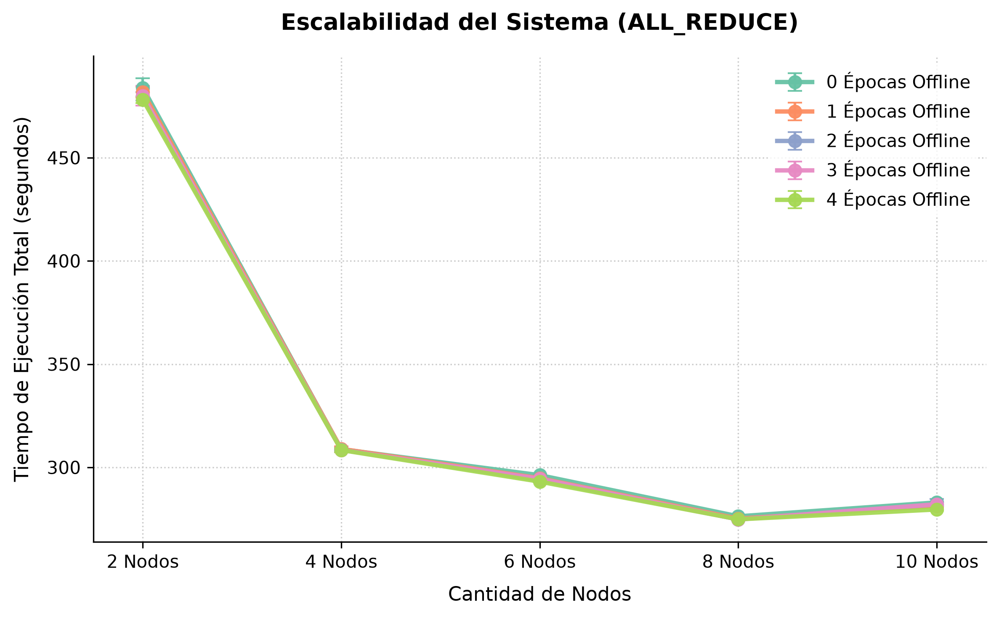
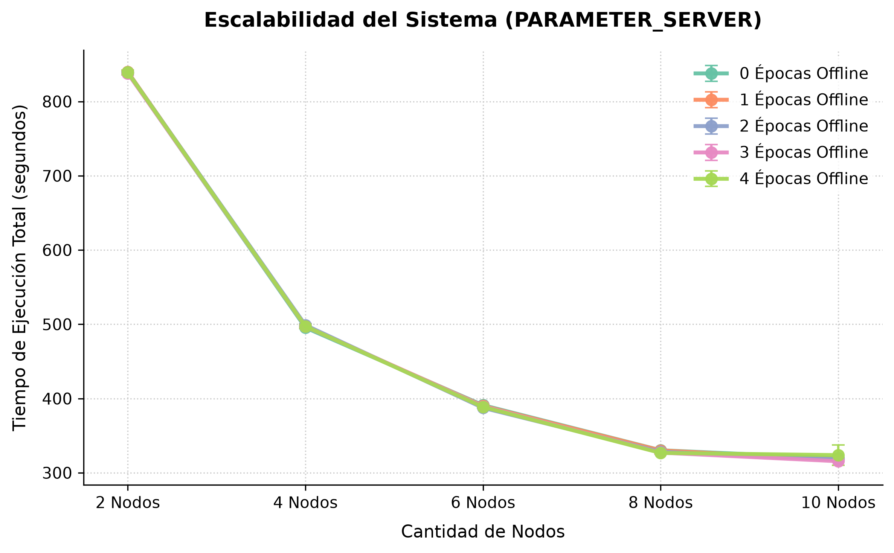
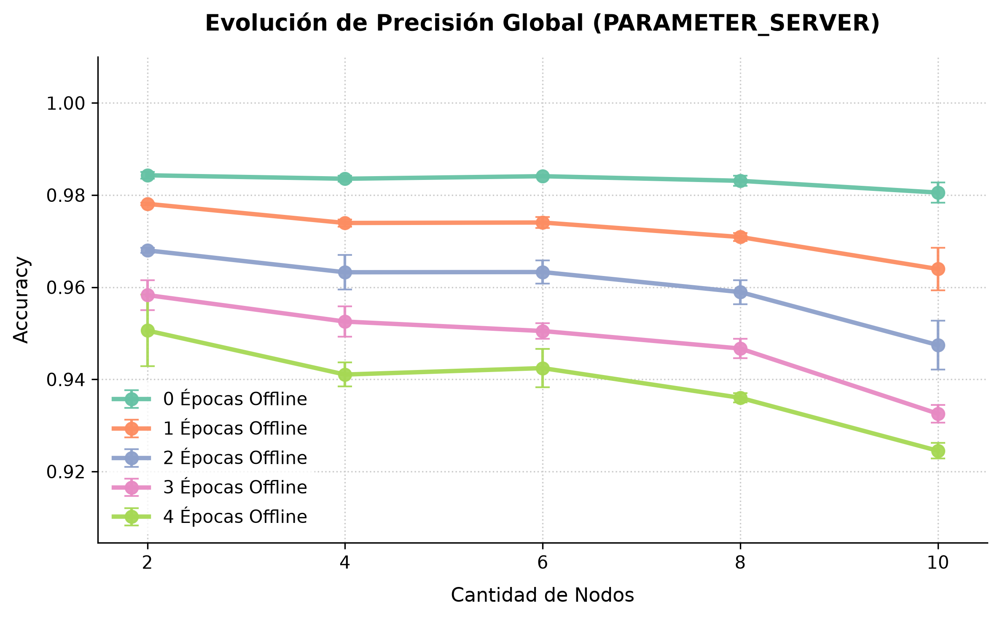
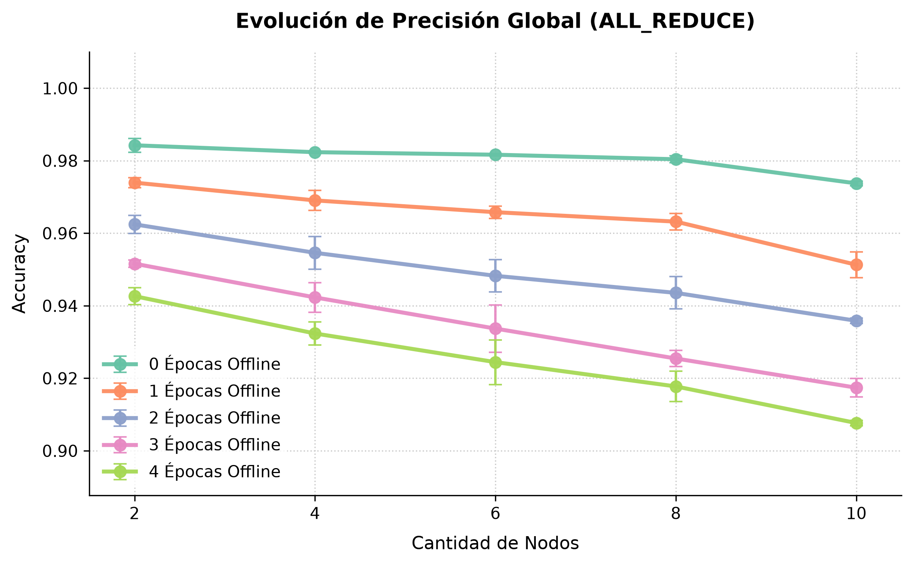
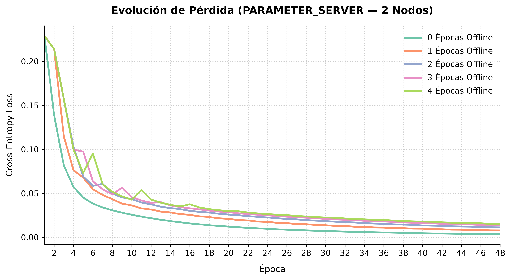
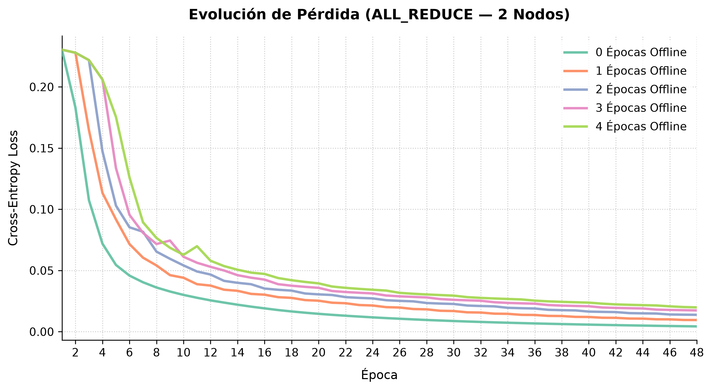

\newpage
## Estudio derivado: impacto de los epochs offline {#sec:estudio-derivado}

La comparación anterior mantuvo fijos todos los parámetros del entrenamiento distribuido salvo la estrategia. Esta sección hace lo contrario sobre un único parámetro: fija la estrategia y varía los *epochs offline* ($E$), la cantidad de epochs adicionales que cada nodo entrena de forma autónoma antes de sincronizar: con $E$ epochs offline, cada ronda de sincronización abarca $E+1$ epochs de entrenamiento local. Es un estudio derivado, en el sentido de que no compara estrategias entre sí sino que aprovecha la instrumentación de O.N.O. para medir el efecto aislado de una decisión de configuración; se desarrolló originalmente como una de las monografías individuales de la materia Aprendizaje Profundo y se reproduce aquí porque valida que la base sirve también para esa clase de preguntas.

### Pregunta e hipótesis {#sec:hipotesis-oe}

Permitir que los nodos operen de forma autónoma durante varios epochs posterga el intercambio de parámetros, disminuyendo la dependencia de la red y priorizando el cómputo local. Sin embargo, demorar la sincronización introduce divergencia entre los pesos de los nodos, un fenómeno conocido como *client drift* [@mcmahan2017federated]. O.N.O. expone este mecanismo como un parámetro de configuración, los epochs offline ($E$), lo que permite estudiarlo de forma directa.

La pregunta es: ¿Cómo impacta la variación de los epochs offline $E$ en la velocidad de convergencia, el tiempo de comunicación y la eficacia del modelo entrenado bajo distintas topologías de red en un entorno distribuido con restricciones de red reales?

Las hipótesis de partida fueron tres. La primera, que incrementar $E$ reduce el tiempo de ejecución, porque reduce en la misma proporción la cantidad de sincronizaciones. La segunda, que incrementar $E$ degrada la exactitud final, por el *client drift* entre réplicas. La tercera, que esa degradación se manifiesta como inestabilidad de la pérdida, y que esa inestabilidad es mayor en All-Reduce que en Parameter Server, porque en el esquema descentralizado no existe un servidor que concentre el estado del optimizador.

### Metodología

Se ejecutaron entrenamientos sobre una misma arquitectura, conjunto de datos e hiperparámetros, variando únicamente el algoritmo distribuido, la cantidad de nodos y el valor de $E$. Todos los ensayos se realizaron de forma secuencial sobre la misma máquina, sumando un total de 11 horas y 15 minutos de ejecución.

| Categoría        | Parámetro            | Valores                                                                        |
|------------------|----------------------|--------------------------------------------------------------------------------|
| Modelo y datos   | Dataset              | MNIST completo [@lecun1998gradient]                                            |
|                  | Arquitectura         | LeNet-5                                                                        |
|                  | Función de pérdida   | Entropía cruzada                                                               |
| Optimización     | Optimizador          | Adam ($\alpha=0{,}01$; $\beta_1=0{,}9$; $\beta_2=0{,}999$; $\epsilon=10^{-8}$) |
|                  | Tamaño de mini-batch | 64                                                                             |
|                  | Epochs máximos       | 48                                                                             |
| Infraestructura  | Serialización        | Dispersa ($r=0{,}5$)                                                           |
| Variables libres | Algoritmo            | All-Reduce, Parameter Server sincrónico                                        |
|                  | Nodos                | 2, 4, 6, 8, 10                                                                 |
|                  | Epochs offline       | 0, 1, 2, 3, 4                                                                  |

: Configuración de los ensayos. En Parameter Server, la mitad de los nodos son workers y la otra mitad servidores.

Al parametrizar $E>0$, los nodos entrenan aislados durante múltiples ciclos y el tráfico de red se reduce de forma aproximada inversamente proporcional a $E$. Al alcanzar la etapa de sincronización, la consolidación se realiza por promedio directo de los gradientes parciales, de modo que bajo descenso por gradiente la actualización responde a

$$W_{t + 1} = W_{t} - \frac{\lambda}{N} \sum_{i=1}^{N} G_{i}^{(E)},$$

donde $W_t$ son los parámetros del modelo tras la $t$-ésima sincronización, $\lambda$ es la tasa de aprendizaje, $N$ es la cantidad de workers y $G_i^{(E)}$ es el gradiente que el worker $i$ acumuló a lo largo de las $E+1$ epochs locales de la ronda. Entre dos sincronizaciones consecutivas transcurren entonces $E+1$ epochs.

Los ensayos se realizaron con la serialización dispersa que implementa el sistema, siguiendo el enfoque de Aji y Heafield [-@aji2017sparse]. El parámetro $r$ es la fracción de componentes del gradiente que se transmiten: el umbral se fija en el percentil $(1-r)$ de las magnitudes del gradiente local, de modo que solo viajan, aproximadamente, los $r \cdot |g|$ componentes de mayor magnitud absoluta. Los componentes que no superan el umbral no se descartan: permanecen en un gradiente residual que el worker conserva entre rondas. Los componentes enviados se ponen en cero en ese residual, y el gradiente de la ronda siguiente se suma sobre él antes de recalcular el umbral, de modo que un componente pequeño pero persistente termina superándolo en alguna ronda posterior. Con $r=0{,}5$, la mitad de los componentes queda fuera de cada mensaje.

El entorno de ejecución, una máquina de cuatro núcleos físicos sobre la que Pumba emuló una red hogareña típica en retardo, *jitter* y ancho de banda, se detalla en la Sección \ref{sec:entorno}.

### Resultados: tiempo de ejecución

La variación de $E$ no indujo mejoras significativas en los tiempos de ejecución: las curvas de cada configuración se solapan de forma estricta en todos los ensayos. Dado que el sistema se ejecuta en una única máquina, la supresión del costo de comunicación no alcanza a compensar la sobrecarga de cómputo, contrariamente a la expectativa inicial.

{width=70%}

La escalabilidad del rendimiento se estanca al superar los 4 nodos, y en All-Reduce la elevación a 10 nodos degrada el desempeño global por la alta contención de CPU.

{width=70%}

En Parameter Server, en cambio, la configuración de 10 nodos (5 workers y 5 servidores) reduce el tiempo respecto de configuraciones menores. La explicación es contraintuitiva pero consistente con el entorno: mientras que en All-Reduce los procesos operan en cómputo continuo, el esquema sincrónico de Parameter Server introduce estados de inactividad obligatorios mediante barreras, y esa inactividad disminuye la contención, permitiendo una alternancia más eficiente de los hilos de ejecución sobre los cuatro núcleos físicos disponibles. All-Reduce resulta, no obstante, más veloz que Parameter Server en todas las configuraciones evaluadas, por su distribución balanceada de responsabilidades sin dependencias centralizadas; la diferencia es máxima con 2 nodos y se reduce a medida que crece su cantidad.

### Resultados: exactitud

El impacto de $E$ se manifiesta con mayor claridad en la exactitud, por ser una métrica independiente de las limitaciones del hardware de ejecución. En ambos algoritmos, la exactitud final decrece de forma monótona al incrementar $E$. La introducción de un único epoch offline ($E=1$), que reduce la frecuencia de sincronización global a la mitad, ya provoca un deterioro inmediato de aproximadamente un punto porcentual.

{width=70%}

La degradación se acentúa de forma proporcional al número de nodos. Al incrementar las entidades distribuidas, las particiones locales del conjunto de datos se reducen y se vuelven potencialmente sesgadas; la falta de sincronización frecuente exacerba el impacto de esos sesgos locales, perjudicando la convergencia global.

{width=70%}

En All-Reduce la pérdida de exactitud es más severa que en Parameter Server. Esto se explica por el diseño experimental: bajo las condiciones evaluadas, All-Reduce duplica el número de workers activos al prescindir de servidores dedicados, lo que fragmenta aún más el conjunto de datos e incrementa el aislamiento operativo. La integración tardía de parámetros fuerza entonces correcciones abruptas del gradiente global.

### Resultados: inestabilidad de la pérdida

A partir del historial de entrenamiento se seleccionaron trayectorias representativas que confirman que el incremento de $E$ introduce inestabilidad en la función de pérdida, evidenciada mediante oscilaciones y picos proporcionales al valor de $E$.

{width=70%}

La dinámica del optimizador presenta mayores dificultades en los epochs iniciales, la fase asociada a las correcciones de mayor magnitud, y luego se estabiliza al aproximarse a un mínimo local. Sin embargo, los valores de convergencia residual son sistemáticamente más altos a mayor $E$. El fenómeno sugiere que el desacoplamiento prolongado restringe la capacidad del optimizador para alcanzar el mínimo, induciendo un comportamiento análogo al de una tasa de aprendizaje excesivamente alta.

{width=70%}

En All-Reduce se observa un patrón similar, aunque con oscilaciones relativamente más atenuadas, lo que contradice la tercera hipótesis planteada en la Sección \ref{sec:hipotesis-oe}, que preveía mayor inestabilidad en el esquema descentralizado.

### Discusión y limitaciones {#sec:discusion-oe}

La ventaja de introducir epochs offline es estrictamente reducir el tiempo de entrenamiento. En un entorno local simulado, reducir el costo de comunicación no compensa el costo de obtener un peor modelo: en estos experimentos no se evidenció ninguna ventaja de utilizar un $E$ mayor a 0.

En contraposición, en un despliegue multimáquina sobre una red física, retrasar la agregación de gradientes puede resultar crítico para amortizar el tiempo de comunicación. La decisión depende de tres factores: el tamaño del modelo, la velocidad de la red y la cantidad de nodos. Con modelos más grandes, los mensajes que contienen gradientes y parámetros son también más grandes. Para entrenamientos con mucho dato y poco modelo, el cuello de botella es el cómputo de gradientes; en cambio, para entrenamientos con poco dato y mucho modelo, donde la comunicación toma protagonismo, incrementar $E$ puede ser útil para reducir los tiempos de ejecución.

Un resultado del estudio que merece señalarse es que la desestabilización afecta negativamente al modelo de forma predecible. Las trayectorias de pérdida muestran, además, que la brecha entre las configuraciones con $E>0$ y la configuración sin epochs offline es máxima en las primeras epochs, pero no se cierra en las últimas: en las trayectorias presentadas, ninguna configuración con $E>0$ alcanza la pérdida final de $E=0$. Esto deja abierta, aunque sin evidencia a favor en estos datos, una línea concreta: evaluar estrategias de activación dinámica de los epochs offline, que los introduzcan solo una vez estabilizada la pérdida, con un criterio análogo al que usa Strategy-Switch para cambiar de régimen, y medir si así se conserva la ganancia en comunicación sin el costo en exactitud que se observó al aplicarlos desde el inicio.

### Conclusión del estudio

El uso de epochs offline en O.N.O. altera el balance entre comunicación y fidelidad algorítmica. En la infraestructura simulada, incrementar $E$ perjudicó al modelo entrenado de manera predecible pero sin aportar ganancias de velocidad, debido a las limitaciones del hardware empleado. Queda planteado validar el sistema bajo configuraciones multimáquina reales, comparando arquitecturas de modelos de distintos tamaños al variar $E$.
