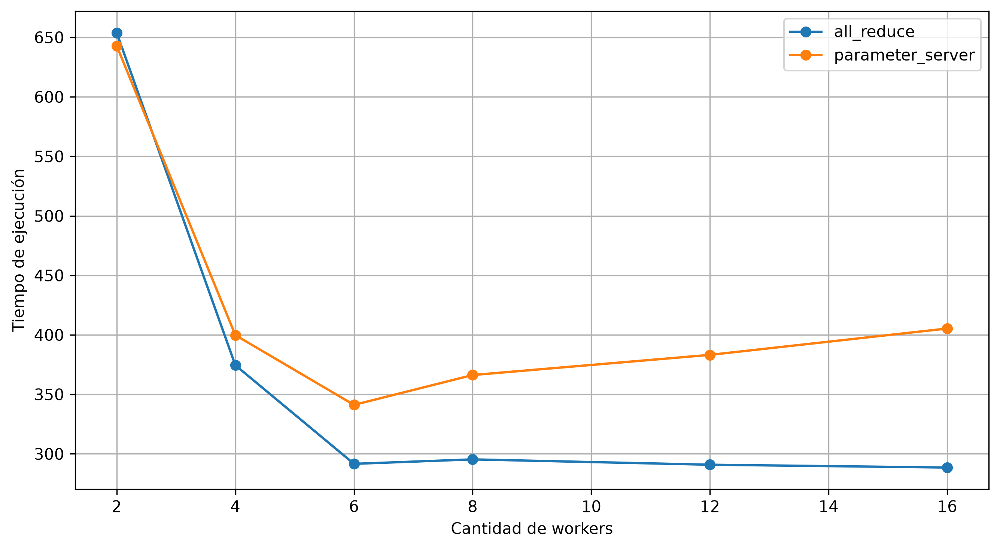
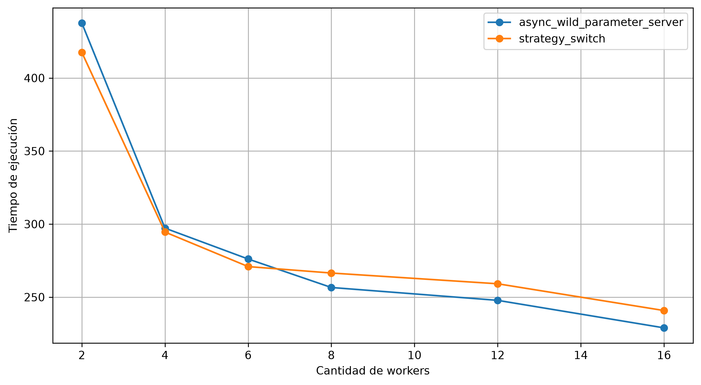
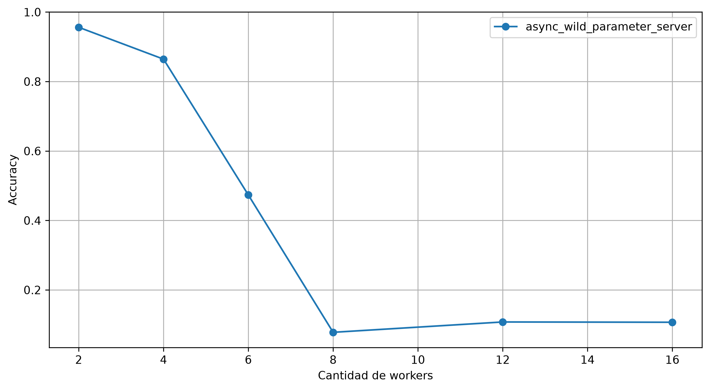
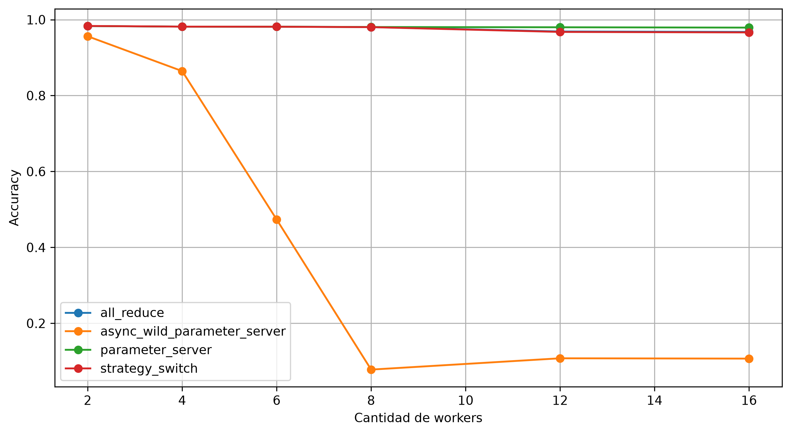

\newpage
## Resultados {#sec:resultados}
El objetivo principal de los algoritmos que se implementan en este trabajo es el de reducir el tiempo de entrenamiento de un modelo de deep learning, $T_1$, que está dado por la suma de $T_\text{ser}$ y $T_\text{par}$, los tiempos de procesamiento de las porciones de trabajo serializado y paralelizable, respectivamente.  
Dado que $T_\text{ser}\ll T_\text{par}$, pues, para los algoritmos que se presentan, el trabajo serializado consiste en compartir el dataset y la metadata del modelo entre los nodos, y que además $T_{ser}$ no cambia entre los algoritmos, porque en todos ellos necesita compartirse esa información; se desprecia $T_\text{ser}$ y se habla de $T_\text{par}$ como $T_1$ en el contexto de la comparativa.

Si el costo de sincronización entre nodos fuera despreciable, el tiempo de entrenamiento sería inversamente proporcional a la cantidad de nodos $P$:
$$
T_P = \frac{T_1}{P}.
$$
En la práctica, el costo de sincronización no es despreciable; más aún, se verá más adelante que en algunos casos puede incluso crecer con la cantidad de máquinas que deben sincronizarse.

El tiempo total de entrenamiento distribuido está dado por la combinación del tiempo de ejecución local y el delay de sincronización y de inicialización:
$$
T_\text{total} = N_\text{epochs} \cdot \left(\frac{T_\text{epoch}}{N_W} + d_\text{sync}\right) + d_\text{inicialización},
$$
donde $T_\text{total}$ es el tiempo total de ejecución del entrenamiento distribuido, $N_\text{epochs}$ es la cantidad de épocas de entrenamiento, $T_\text{epoch}$ es el tiempo de ejecución promedio de cada época, $N_W$ es la cantidad de workers en el sistema distribuido, $d_\text{sync}$ es el delay de sincronización en cada iteración y $d_\text{inicialización}$ es el delay de inicialización del entrenamiento distribuido.  
En un entorno de computación distribuida, una pasada por el dataset en cada epoch se divide entre la cantidad de workers que las computan.

Las subsecciones que siguen derivan el delay de sincronización $d_\text{sync}$ para cada estrategia. Las expresiones son de elaboración propia: se obtienen a partir de los supuestos enunciados y de la descripción de cada algoritmo en la literatura citada, y no se toman de ninguna fuente. El contraste entre esos valores esperados y los medidos sobre O.N.O. se presenta en la Sección \ref{sec:resultados-obtenidos}.

### Parameter Server sincrónico con un solo servidor
En Parameter Server [@10.5555/2685048.2685095] con un solo server, el delay que introduce la sincronización del sistema está dado por el tiempo de comunicación de la ida de los parámetros del server hacia los workers, y de la vuelta de los gradientes de los workers hacia el server.  

Suponiendo un mismo bandwidth $R$ para todos los nodos, delays de encolado, propagación y procesamiento despreciables; y un modelo de tamaño $S$ ($S=N_\text{params} \times 2 \ \text{bytes}$, dado que los parámetros se serializan como flotantes de 16 bits); el tiempo que tarda la ida de los parámetros es el de su envío en $N_W$ mensajes unicast $N_W \frac{S}{R}$.  
Suponiendo un ambiente homogéneo, en el que el tiempo de procesamiento de los workers es similar, todos comienzan a contestar con los respectivos gradientes en simultáneo. Sin embargo, el server solo tiene una tarjeta de red con la cual recibir estos gradientes, por lo que el tiempo que tarda la vuelta de los gradientes es también $N_W \frac{S}{R}$.  

El delay de sincronización $d_\text{sync}^\text{PS}$ de Parameter Server sincrónico con un solo servidor es entonces
$$
d_\text{sync}^\text{PS} = 2 N_W \frac{S}{R}.
$$
Nótese que el delay crece con la cantidad de workers.

Cabe destacar que generalmente uno querría que el nodo que ejecuta el parameter server ejecute también un worker, dado que de otra forma se estaría desperdiciando su CPU siendo que la entidad del server está limitada por I/O. En cuyo caso el delay de comunicación entre el parameter server y el worker que residen en el mismo nodo se anula, y por tanto $d_\text{sync}^\text{PS} = 2 (N_W-1) \frac{S}{R}$.

### Ring All-Reduce
El delay de sincronización de Ring All-Reduce [@patarasuk2009bandwidth] está dado por el delay del *scatter* y por el delay del *gather*. Ambas etapas del algoritmo son de $N_W-1$ iteraciones. En ambas, la sincronización en una iteración consiste en enviar una $N_W$-ésima parte del gradiente del $i$-ésimo al $i+1$-ésimo nodo. Dado que se desprecian los delays de encolado, propagación y procesamiento; y que las tarjetas de red son *full-duplex* (tienen canales dedicados para leer y escribir); puede pensarse que la comunicación en anillo se realiza en paralelo.

Considerando los mismos supuestos de delays de comunicación por red que se usaron para el desarrollo anterior, el delay de sincronización de All-Reduce, está dado por hacer dar vuelta una $N_W$-ésima parte del gradiente dos veces. Esto es
$$
\begin{aligned}
d_\text{sync}^\text{AR} &= 2(N_W - 1) \frac{S/N_W}{R}\\
&=2(1-\frac{1}{N_W}) \frac{S}{R}.
\end{aligned}
$$

A diferencia de Parameter Server, el factor afectado por la cantidad de workers $\frac{1}{N_W}\rightarrow 0$ cuando $N_W\rightarrow \infty$,
$$
\lim_{N_W\rightarrow \infty} d_\text{sync}^\text{AR} = 2 \frac{S}{R}.
$$
El delay de sincronización está acotado por el doble del delay de transmisión del tamaño de los parámetros del modelo.

### Parameter Server sincrónico con $N_S$ servers
Como ya se vio, la mayor parte del delay de sincronización en Parameter Server viene del hecho de que todos los workers tienen que comunicarse con un único servidor, y dado que este servidor puede enviar y recibir una sola tira de parámetros/gradientes a la vez, el delay escala con $N_W$.  
Una forma de resolver este problema es incrementar la cantidad de servidores. Cada servidor tiene una porción disjunta de los parámetros del modelo, y los workers solicitan parámetros y envían gradientes al servidor que corresponda.

En Parameter Server, por tratarse de comunicación de uno a muchos, el cuello de botella de la sincronización está del lado del servidor. Con un solo servidor ya se vio que el envío de parámetros y la recepción de gradientes ambos tardan $N_W \frac{S}{R}$, que es el máximo entre el delay desde el punto de vista de un worker y desde el del server: $\max{\left(\frac{S}{R}, N_W \frac{S}{R}\right)}$. Pero con $N_S$ servers, el delay del lado del servidor se transforma en $N_W \frac{S/N_S}{R}$. Por lo tanto
$$
d_\text{sync}^\text{Multi-PS} = 2 \frac{N_W}{N_S} \frac{S}{R} \qquad (N_S\leq N_W).
$$
Nótese que cuando $N_S=N_W$, $d_\text{sync}^\text{Multi-PS} = 2 \frac{S}{R}$, que es el mismo resultado obtenido que para All-Reduce cuando $N_W$ crece indefinidamente.

Vale la misma aclaración que se hizo en el caso para un solo servidor con respecto a que los nodos que ejecutan un server normalmente van a estar también ejecutando un worker, por lo que los delays de transmisión se anulan en esos nodos: $d_\text{sync}^\text{Multi-PS} = 2 \frac{N_W-1}{N_S} \frac{S}{R}$.

### Parameter Server asincrónico
El delay de sincronización desarrollado en los puntos anteriores se da luego de cada ronda de epochs de *todos* los workers. Esto es, cada worker computa una epoch para luego sincronizar sus parámetros con el resto, o más de una si se configuran epochs offline. Esto último reduce la cantidad de sincronizaciones, y por lo tanto solo resulta deseable cuando el costo de comunicación domina sobre el de cómputo, por ejemplo con modelos grandes o redes lentas, y a costa de una mayor divergencia entre réplicas, como se analiza en la Sección \ref{sec:estudio-derivado}.

Parameter Server asincrónico libera al entrenamiento distribuido de esta restricción, dejando que el parameter server mueva los parámetros del modelo a medida que van llegando gradientes de los workers *sin necesidad de esperar al resto*. En este caso el costo de sincronización se elimina porque la sincronización simplemente desaparece, aunque aún se tiene que considerar el delay de transmisión $2\frac{S}{R}$ de cada worker.  
Si un gradiente llega mientras el servidor todavía está aplicando el anterior, no se descarta ni dispara una actualización simultánea: en el almacenamiento con bloqueo por fragmento (`BlockingStore`), el servidor mantiene dos buffers de gradientes, de modo que el que llega se acumula en el buffer libre y se aplica en la actualización siguiente, junto con los demás que lleguen en ese intervalo. Si las llegadas son más frecuentes que lo que tarda una actualización, el efecto es que varias contribuciones se agregan en un mismo paso del optimizador, y no que se pierdan.

El problema con esta estrategia es que la convergencia empeora mucho cuando la desincronización es grande, es decir, cuando los workers mueven demasiado los pesos en la dirección sesgada que les dicta su partición de los datos; fenómeno conocido como *client drift* [@mcmahan2017federated].

### Strategy-Switch
Strategy-Switch [@provatas2025strategyswitch] combina la convergencia de All-Reduce y la velocidad de ejecución de Parameter Server asincrónico. La idea es encontrar un buen mínimo local con el primer algoritmo para luego seguir bajándolo por medio del segundo.  
Considerando que $d_\text{sync}$ es el tiempo en el que los nodos permanecen sin realizar ningún cómputo, ni comunicarse directamente con otro nodo, por esperar que termine la sincronización, puede decirse entonces que luego del switch ese tiempo puede llegar a anularse: su cota inferior es cero, que corresponde al caso en que ningún worker encuentra al servidor ocupado. En el peor de los casos, cuando todos los nodos se comunican con el parameter server en simultáneo, el delay llega a $d_\text{sync}^\text{PS}$.

El delay de sincronización de Strategy-Switch depende entonces de si se realizó el *switch*:
$$
d_\text{sync}^\text{SS} =
\begin{cases}
2(1-\frac{1}{N_W}) \frac{S}{R}, & \text{antes del switch (All-Reduce)}\\
d_\text{sync}^\text{Async PS}, & \text{después (Parameter Server asincrónico)}.
\end{cases}
$$
con $0\leq d_\text{sync}^\text{Async PS}\leq d_\text{sync}^\text{PS}$.

### Resultados obtenidos {#sec:resultados-obtenidos}
Los resultados se obtuvieron sobre MNIST [@lecun1998gradient], con la arquitectura, los hiperparámetros y el barrido de workers detallados en la *Metodología de experimentación y validación*, y sobre el entorno simulado descrito en esa misma sección.

Un factor clave en el delay de sincronización es el tamaño del modelo $S$ frente al bandwidth $R$ de la red, es decir, el delay de transmisión $d_\text{trans}$. Como el tamaño de los modelos que resultan útiles para aprender MNIST no basta para que ese cociente produzca diferencias observables entre estrategias, se fijó $R=10 \ \text{Mbit/s}$, deliberadamente muy inferior al de una red real, en lugar de recurrir a un modelo innecesariamente grande o de cambiar el problema por uno que así lo requiera. Con un modelo de $S\approx 1$ Mbit ($\approx 0{,}12$ MB) y ese bandwidth, el delay de transmisión es $d_\text{trans}\approx 0{,}1 \ \text{segundos}$.

El objetivo de un algoritmo de entrenamiento distribuido es lograr una ganancia en performance que justifique el costo de ejecución en un ambiente multi máquina, garantizando al mismo tiempo que el modelo converja; de lo contrario, el entrenamiento en sí pierde todo sentido.

Se muestra primero la comparativa de resultados de los algoritmos que operan de manera sincrónica.

{width=78%}

Tal como predice el análisis teórico, la performance de Parameter Server empeora a partir de $N_W=6$. Esto se debe a que el servidor único actúa como cuello de botella y el delay de sincronización crece linealmente con los workers. En contraste, Ring All-Reduce demuestra ser una topología mucho más eficiente a medida que el sistema escala, puesto que el tiempo de ejecución no se degrada porque su delay está acotado.  
Sin embargo, esta sincronización estricta acota la aceleración que proveen estos algoritmos por sobre la ejecución en una sola computadora. Al agregar workers, el término de cómputo $T_\text{epoch}/N_W$ tiende a cero, pero $d_\text{sync}^\text{AR}$ tiende a $2S/R$, de modo que el tiempo total nunca baja de $N_\text{epochs} \cdot 2(1-\frac{1}{N_W})\frac{S}{R}$, y a partir de cierta cantidad de workers deja de disminuir.

A continuación se muestran los resultados obtenidos para las estrategias asincrónicas: Parameter Server asincrónico con un solo server y Strategy-Switch.

{width=78%}

En términos exclusivos de velocidad, ambos algoritmos logran resultados excelentes. Al romper la barrera de sincronización estricta, evitan el cuello de botella de Ring All-Reduce y logran que el tiempo de ejecución siga bajando a medida que se suman workers.  
No obstante, el tiempo de ejecución carece de valor si el modelo no aprende. Al examinar cómo evoluciona la accuracy obtenida sobre el set de test en Parameter Server asincrónico, se observa que la acumulación de gradientes de manera descontrolada arruina por completo los resultados de convergencia, como muestra la figura siguiente.

{width=78%}

El hecho de que cada worker empuje para su lado pesa mayormente al principio del entrenamiento, cuando los workers no se encuentran en mínimos locales acordados en conjunto.  
Strategy-Switch aprovecha la velocidad de la desincronización en el momento indicado para no perder la convergencia, cuando los mínimos locales sí fueron consensuados de antemano.

{width=78%}

En esta campaña, el híbrido obtiene el mejor balance de los evaluados: logra una exactitud similar a la de los algoritmos sincrónicos y una velocidad de ejecución similar a la del asincrónico.

Este análisis tiene una salvedad que conviene explicitar. En esta campaña, Parameter Server asincrónico se ejecutó con `WildStore`, la variante de actualización libre de bloqueos que escribe sobre los parámetros compartidos sin protección y cuyas limitaciones se describen en el Anexo \ref{sec:riesgos}. El colapso de exactitud observado es consistente con el *client drift*, pero estos datos no permiten descartar que las escrituras concurrentes sin protección contribuyan a él. Separar ambos efectos requiere repetir la campaña con el almacenamiento con bloqueo por fragmento (`BlockingStore`), lo que queda planteado como trabajo futuro.
